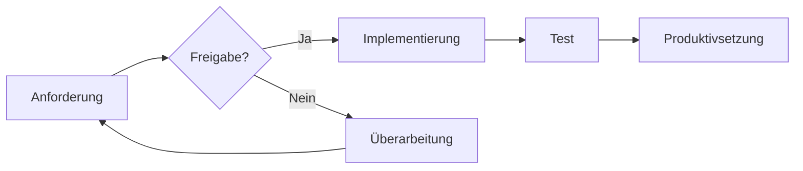
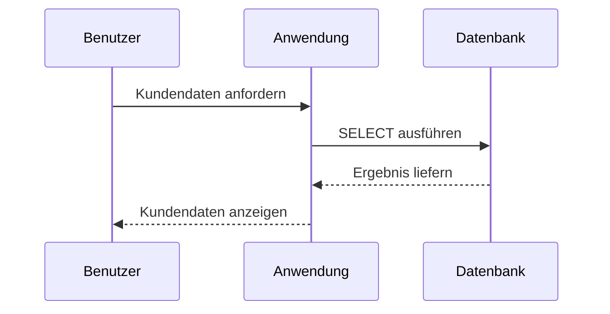
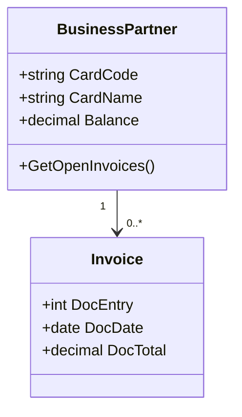

# Markdown Example

---

title: "Umfassendes Markdown-Beispieldokument ohne HTML"
author: "Mark Klein"
date: 2026-10-31
tags:

  - Markdown
  - Dokumentation
  - Test
version: 1.0
---

# Umfassendes Markdown-Beispieldokument ohne HTML

> **Hinweis:** Dieses Dokument demonstriert Standard-Markdown und verbreitete Erweiterungen ohne eingebetteten HTML-Code. Nicht jeder Markdown-Renderer unterstützt alle gezeigten Funktionen.

[[_TOC_]]

## 1. Überschriften

# Überschrift Ebene 1

## Überschrift Ebene 2

### Überschrift Ebene 3

#### Überschrift Ebene 4

##### Überschrift Ebene 5

###### Überschrift Ebene 6

Alternative Schreibweise für Ebene 1
====================================

Alternative Schreibweise für Ebene 2
------------------------------------

## 2. Textformatierung

Normaler Fließtext mit einem  
erzwungenen Zeilenumbruch durch zwei Leerzeichen am Zeilenende.

**Fett**, __ebenfalls fett__, *kursiv*, _ebenfalls kursiv_ und ***fett-kursiv***.

~~Durchgestrichener Text~~ und ==hervorgehobener Text==, sofern der Renderer dies unterstützt.

H~2~O als Tiefstellung und E = mc^2^ als Hochstellung, sofern der Renderer dies unterstützt.

Ein einzelnes Wort kann als `Inline-Code` dargestellt werden. Tastenkombination: `Ctrl + C`.

Ein Backslash maskiert Sonderzeichen: \*nicht kursiv\* und \# keine Überschrift.

## 3. Absätze und Trennlinien

Dies ist der erste Absatz. Eine Leerzeile beendet ihn.

Dies ist der zweite Absatz.

---

***

___

## 4. Zitate

> Dies ist ein einfaches Zitat.
>
> Es kann mehrere Absätze enthalten.

> Zitat der ersten Ebene
>> Verschachteltes Zitat
>>> Noch eine Ebene tiefer

> ### Überschrift innerhalb eines Zitats
> - Listen funktionieren ebenfalls.
> - Ebenso **Formatierungen** und `Code`.

## 5. Ungeordnete Listen

- Erster Eintrag
- Zweiter Eintrag
  - Unterpunkt A
  - Unterpunkt B
    - Dritte Ebene
- Dritter Eintrag

* Sternchen funktionieren ebenfalls

+ Ebenso Pluszeichen

## 6. Geordnete Listen

1. Analyse
2. Umsetzung
3. Test
4. Dokumentation
1. Automatisch nummerierter Punkt
1. Noch ein Punkt
1. Ein weiterer Punkt
5. Eine Liste kann bei fünf beginnen
6. und entsprechend fortgesetzt werden

## 7. Gemischte und verschachtelte Listen

1. Vorbereitung
   - Anforderungen erfassen
   - Beteiligte bestimmen
2. Implementierung
   1. Datenmodell erstellen
   2. Schnittstelle entwickeln
3. Abschluss
   - [x] Test durchführen
   - [ ] Dokumentation freigeben

## 8. Aufgabenlisten

- [x] Markdown-Datei erstellen
- [x] Überschriften ergänzen
- [x] Tabellen demonstrieren
- [ ] Renderer-Kompatibilität prüfen
- [ ] Dokument veröffentlichen

## 9. Links

## 10. Bilder

> Externe Bilder werden nur angezeigt, wenn der Renderer Internetzugriff erlaubt.

## 11. Einfache Tabelle

| ID | Name | Status |
|---:|:-----|:------:|
| 1 | Alpha | Aktiv |
| 2 | Beta | In Prüfung |
| 3 | Gamma | Beendet |

## 12. Erweiterte Tabelle

| Funktion | Syntax | Beispiel | Bemerkung |
|:---------|:-------|:---------|:----------|
| Fett | `**Text**` | **Text** | Standard |
| Kursiv | `*Text*` | *Text* | Standard |
| Code | `` `Code` `` | `Code` | Standard |
| Durchgestrichen | `~~Text~~` | ~~Text~~ | Erweiterung |
| Aufgabenfeld | `- [x] Aufgabe` | ☑ Aufgabe | GFM |

## 13. Inline-Code und Codeblöcke

Inline-Code: `SELECT CardCode, CardName FROM OCRD;`

Eingerückter Codeblock:

    Dieser Text wurde mit vier Leerzeichen eingerückt.
    Er wird als Code ausgegeben.

Codeblock ohne Sprachangabe:

```
Ein neutraler Codeblock
mit mehreren Zeilen.
```

## 14. JSON-Beispiel

```json
{
  "CardCode": "C10000",
  "CardName": "Beispielkunde GmbH",
  "active": true,
  "creditLimit": 25000.00
}
```

## 15. SQL-Beispiel

```sql
SELECT
    T0.CardCode,
    T0.CardName,
    T0.City,
    T0.Balance
FROM OCRD AS T0
WHERE T0.CardType = 'C'
  AND T0.frozenFor = 'N'
ORDER BY T0.CardName;
```

## 16. Weitere Codebeispiele

### PowerShell

```powershell
Get-ChildItem -Path "C:\Logs" -Filter "*.log" |
    Sort-Object LastWriteTime -Descending |
    Select-Object -First 10
```

### Bash

```bash
find /var/log -type f -name "*.log" -mtime -7
```

### XML

```xml
<BusinessPartner active="true">
  <CardCode>C10000</CardCode>
  <CardName>Beispielkunde GmbH</CardName>
</BusinessPartner>
```

### C#

```csharp
public record BusinessPartner(string CardCode, string CardName);

var customer = new BusinessPartner("C10000", "Beispielkunde GmbH");
Console.WriteLine(customer.CardName);
```

### Diff

```diff
- alte Einstellung = false
+ neue Einstellung = true
```

## 17. Fußnoten

Markdown kann Fußnoten enthalten.[^1] Eine Fußnote darf auch einen längeren Text besitzen.[^lang]

[^1]: Dies ist eine kurze Fußnote.

[^lang]: Dies ist eine längere Fußnote. Sie kann zusätzliche Informationen und sogar `Inline-Code` enthalten.

## 18. Definitionen

Markdown
: Eine vereinfachte Auszeichnungssprache.

Renderer
: Eine Softwarekomponente, die Markdown in HTML oder ein anderes Ausgabeformat umwandelt.

GFM
: GitHub Flavoured Markdown, eine verbreitete Markdown-Erweiterung.

## 19. Hinweise und Warnungen

> [!NOTE]
> Eine nützliche Zusatzinformation.

> [!TIP]
> Ein praktischer Tipp für die Umsetzung.

> [!IMPORTANT]
> Eine besonders wichtige Information.

> [!WARNING]
> Eine Warnung vor einem möglichen Problem.

> [!CAUTION]
> Ein Hinweis auf ein konkretes Risiko.

## 20. Mathematische Formeln

Inline-Formel: $E = mc^2$

Blockformel:

$$
\sum_{i=1}^{n} i = \frac{n(n+1)}{2}
$$

Eine weitere Formel:

$$
f(x) = \frac{1}{\sqrt{2\pi\sigma^2}} e^{-\frac{(x-\mu)^2}{2\sigma^2}}
$$

## 21. Mermaid-Flussdiagramm



## 22. Mermaid-Sequenzdiagramm



## 23. Mermaid-Klassendiagramm



## 24. Diagramm mit ASCII-Zeichen

```text
+-------------+       +--------------+       +-------------+
| SAP B1      | ----> | Integration  | ----> | Zielsystem  |
+-------------+       +--------------+       +-------------+
```

## 25. Emojis und Sonderzeichen

Direkte Emojis: ✅ ⚠️ ❌ 🚀 📌 🛠️

Emoji-Kürzel, sofern unterstützt: :white_check_mark: :warning: :rocket:

Sonderzeichen: © ® ™ € £ ¥ → ← ↔ ± ≠ ≤ ≥

## 26. Zitat mit Quellenangabe

> Einfachheit ist die Seele der Effizienz.
>
> — Beispielhafte Quellenangabe

## 27. Literatur- und Referenzliste

1. [CommonMark-Spezifikation](https://spec.commonmark.org/)
2. [GitHub-Dokumentation zu Basic Writing](https://docs.github.com/en/get-started/writing-on-github)
3. [Markdown Guide](https://www.markdownguide.org/)

## 28. Kompatibilitätsübersicht

| Funktion | Standard-Markdown | Häufige Erweiterung |
|:---------|:-----------------:|:-------------------:|
| Überschriften | ✅ | |
| Listen | ✅ | |
| Links | ✅ | |
| Bilder | ✅ | |
| Tabellen | | ✅ |
| Aufgabenlisten | | ✅ |
| Fußnoten | | ✅ |
| Mermaid | | ✅ |
| Formeln | | ✅ |
| Hinweise/Alerts | | ✅ |

## 29. Abschluss-Checkliste

- [x] Überschriften
- [x] Textformatierungen
- [x] Listen und Aufgabenlisten
- [x] Links und Bilder
- [x] Tabellen
- [x] Codeblöcke
- [x] Zitate und Hinweise
- [x] Fußnoten und Definitionen
- [x] Formeln
- [x] Mermaid-Diagramme
- [x] Emojis und Sonderzeichen

---

**Ende des Markdown-Beispieldokuments**  
Version 1.0 · Erstellt als Test- und Referenzdatei

